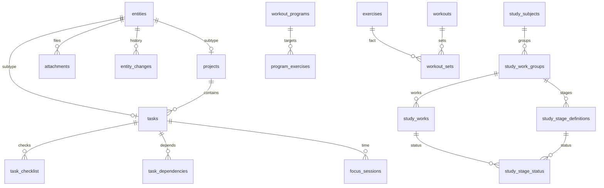

# SQLite v3 / FOCUS OS PRO 0.2.0

Миграции: packages/database/migrations/0002_normalized.ts и 0003_planning.ts. Bootstrap v1 сохраняется для совместимости. Вся работа с SQLite — main process, WAL + foreign_keys=ON. SQL параметризован, версии и доменные изменения транзакционны. Drizzle используется для settings; основные сложные repository-запросы — типизированный SQL adapter.

## Основные связи

- entities — общие именованные поля (title/description/status/priority/estimate/weight/date/time/due/category/tags/created/completed/deleted). JSON только для дополнительной metadata/data.
- projects/tasks/calendar_events/notes/workouts — подтипы entities с SQL FK. Tasks содержит project_id, parent_id, weekly_week, recurrence root/date. Физическое удаление задач/проектов обычным CRUD не выполняется.
- task_checklist, task_dependencies, recurrence_rules с FK на tasks; SQL guards для циклов dependencies/parent и CHECK self-reference.
- focus_sessions.task_id → tasks, числовые секунды/target и состояние.
- study_subjects → aggregate_counts(kind,total,completed), work_groups → works(number), stage_definitions(position). Stage_status имеет составные FK (work_id,group_id)/(stage_id,group_id): этап нельзя привязать к работе другой группы. Статусы done/not_done/unknown, исходные оценки nullable.
- workout_programs → program_exercises → exercises; workouts.program_id; workout_sets → workouts/exercises, reps/weight/done. SQL CHECK не допускает отрицательных величин.
- attachments → entities: BLOB, size CHECK, metadata. Attachment digests → immutable content archive для undo; SHA-256 проверяется при восстановлении.
- project_milestones → projects; planning_constraints хранит date/weekday/time range и blocked/no_complex.
- weekly_snapshots → snapshot_items → tasks с исходными weight/estimate/due; immutable update guard. DTO snapshots дополнительно сохраняют исторический контекст.
- completion_facts → tasks: неизменяемый факт завершения, timestamp/title/estimate/weight/due и дополнительный historical DTO.
- entity_changes → entities: связанный аудит до/после. Legacy change_log сохранён целиком; содержит также настройки/учебные операции. Settings допускают JSON, валидируемый по ключу.

## Безопасный перенос

Для существующей файловой БД сериализуется полная WAL-consistent копия. На migration-check копии исполняются все pending версии; каждый исходный legacy DTO сравнивается с нормализованным чтением. Затем integrity/FK и проверка исходной pre-vN копии. Только после этого миграции применяются к рабочей БД в транзакции. Никаких DROP legacy/перезаписи пользовательского seed. Несогласованные исходные ссылки блокируют перенос с сохранением оригинала.

## Единицы и backup

Timestamps UTC ISO. План: календарная YYYY-MM-DD и HH:mm; недели с понедельника. Estimate/duration — минуты, session.seconds — секунды, distance — км, weight — кг, reps — целое число. Неизвестные grades/distance nullable.

ZIP v3 содержит schema/workspace/checksums, SQLite, машиночитаемые DTO и relations/blobs + историю. Совместим с v1 ZIP. Workspace user/demo нельзя смешивать. Restore валидирует данные и применяет замену транзакционно только по подтверждённому пользователем действию. Миграции заменой данных не пользуются. Старые undo snapshots после внешнего restore очищаются.
